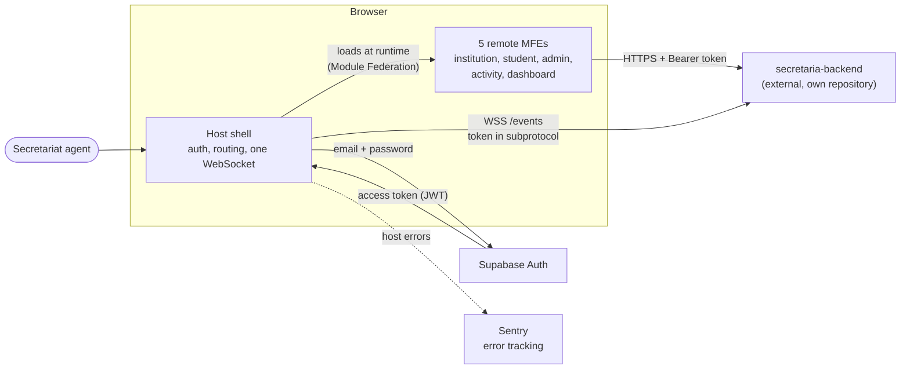
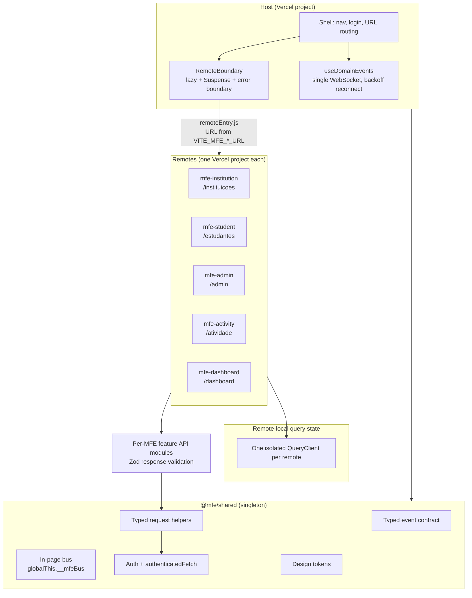
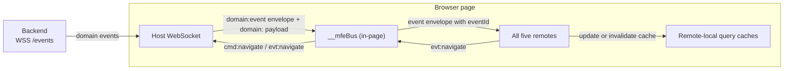
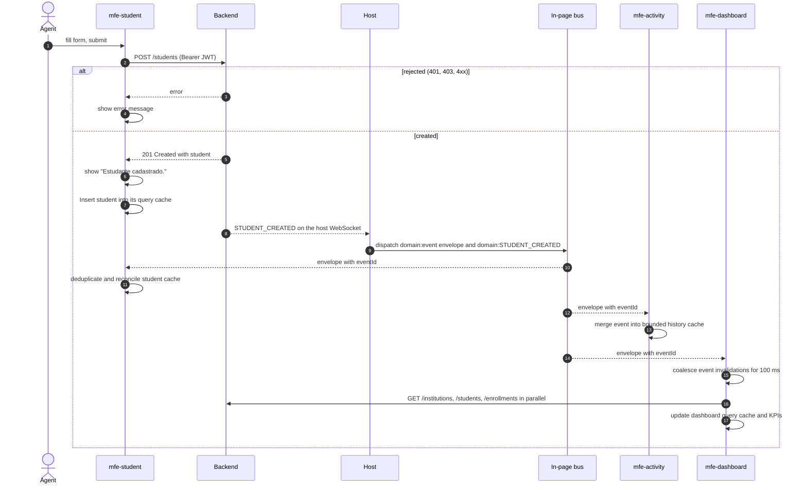
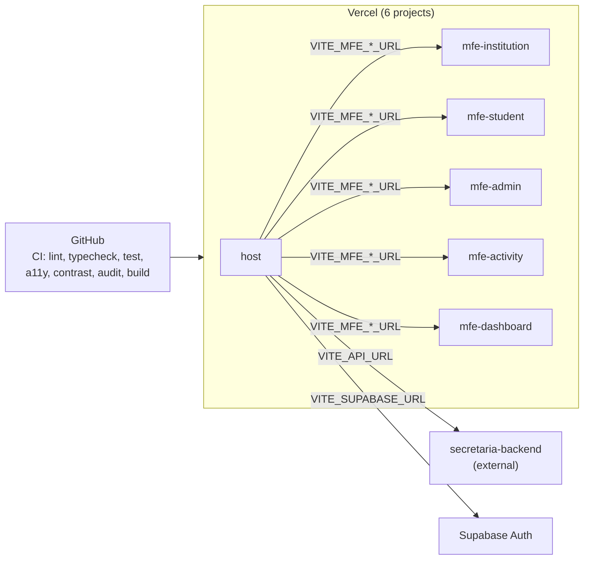

# Architecture

Diagrams for the micro-frontend platform in this repository. The Go API, its data model and its API contract are documented in [`secretaria-backend`](https://github.com/fidelis27/secretaria-backend/blob/main/docs/architecture.md); this page treats it as an external system.

Contents: [1. System context](#1-system-context) · [2. Runtime composition](#2-runtime-composition-in-the-browser) · [3. Communication layers](#3-communication-layers) · [4. Main flow](#4-main-flow-create-a-student) · [5. Event contract](#5-event-contract-frontend-vs-backend) · [6. Deployment](#6-deployment-topology) · [7. Current runtime behavior](#7-current-runtime-behavior)

---

## 1. System context

---

## 2. Runtime composition in the browser

The host owns the shell. Remotes are separate builds, loaded lazily. React,
React DOM, `@mfe/shared`, and `@tanstack/react-query` are federation
**singletons**. Each remote owns a separate `QueryClient` and cache; query data
is not shared across MFEs.

If one remote is down, only its `RemoteBoundary` shows "module unavailable"; the shell and the other remotes keep working.
The per-remote cache decision is documented in [ADR-0001](./adr/0001-query-client-per-remote.md).

---

## 3. Communication layers

Backend events use two communication layers, each with one job.

| Layer                                | Scope                            | Channels                                                                          | Use                                            |
| ------------------------------------ | -------------------------------- | --------------------------------------------------------------------------------- | ---------------------------------------------- |
| Backend domain events over WebSocket | Server to every connected client | event `type` (for example `STUDENT_CREATED`)                                      | State changes that other screens must react to |
| In-page bus                          | Same page only                   | `cmd:*` host to MFE, `evt:*` MFE to host, `domain:*` re-dispatched backend events | Navigation, modal close, connection status     |

Bus delivery rules: no listener means a per-channel queue (100 items, TTL 10 s by default); once a listener exists, delivery is fan-out. Details in [`event-bus.md`](event-bus.md).

HTTP requests follow this path: component → feature query hook → feature API
(`src/features/<feature>/api/`) → shared request helper →
`authenticatedFetch` → backend. Query functions pass their `AbortSignal` to the
API helper. Feature APIs validate JSON responses with Zod schemas and report
typed `ApiError`s containing the HTTP status and backend error when available;
cancelled requests remain abort errors.

---

## 4. Main flow: create a student

The flow the architecture exists to prove: _write, react_. The backend is shown as one box; its internals are in the backend docs.

The student list is updated from the create response and reconciled with the
domain event. Event delivery is best effort; Activity seeds its bounded cache
from `/events/history` on mount and adds supported live events.

---

## 5. Event contract: frontend vs backend

What `@mfe/shared` declares, compared with what the backend emits today.

| Event type                                             | Declared in `@mfe/shared` | Emitted by backend | Consumed by                   |
| ------------------------------------------------------ | ------------------------- | ------------------ | ----------------------------- |
| `STUDENT_CREATED`                                      | yes                       | yes                | Student, Activity, Dashboard  |
| `STUDENT_TRANSFERRED`                                  | yes                       | yes                | Activity, Dashboard           |
| `ENROLLMENT_SUSPENDED`                                 | yes                       | yes                | Activity, Dashboard           |
| `ENROLLMENT_REOPENED`                                  | yes                       | yes                | Activity, Dashboard           |
| `INSTITUTION_CREATED`                                  | yes                       | **no**             | Institution, Admin, Dashboard |
| `INSTITUTION_UPDATED`                                  | yes                       | **no**             | Institution, Admin, Dashboard |
| `INSTITUTION_INACTIVATED`                              | yes                       | **no**             | Institution, Admin, Dashboard |
| `STUDENT_UPDATED`                                      | yes                       | **no**             | Student, Dashboard            |
| `ENROLLMENT_CREATED`                                   | yes                       | yes                | Dashboard                     |
| `USER_UPDATED`                                         | yes                       | yes                | Admin                         |
| `GROUP_MEMBERSHIP_UPDATED`, `GROUP_MEMBERSHIP_REMOVED` | yes                       | yes                | Admin                         |

The frontend schemas match the backend envelope and payloads: institution
scope is carried by the optional `institutionIds` envelope field, while
`ENROLLMENT_SUSPENDED` and `ENROLLMENT_REOPENED` carry only their student and
enrollment identifiers (plus `reason` and `date` for suspension). The backend
emits these payloads in its
[enrollment handlers](https://github.com/fidelis27/secretaria-backend/blob/main/internal/adapters/httpserver/server.go),
[user handler](https://github.com/fidelis27/secretaria-backend/blob/main/internal/adapters/httpserver/user_handler.go)
and
[group handler](https://github.com/fidelis27/secretaria-backend/blob/main/internal/adapters/httpserver/group_handler.go).

---

## 6. Deployment topology

Each package builds and deploys on its own. The host only knows remote origins through build-time variables.

---

## 7. Current runtime behavior

- The host maintains one WebSocket while active. Any remote uses the shared
  authenticated WebSocket fallback only when the host is unavailable.
- Each remote provides its own TanStack `QueryClient`. Cache keys and data are
  isolated by remote; the query library itself is a federation singleton.
- Query functions pass TanStack Query's `AbortSignal` through feature APIs to
  the shared request helper. Unmounting a remote cancels its in-flight queries.
- Student creation inserts the returned resource into the Student cache.
  Validated domain events carry `eventId` through the bus so remotes can
  deduplicate cache updates and invalidations.
- Activity loads the latest 30 events on mount and merges supported live events
  into its bounded cache.
- Dashboard coalesces relevant domain events for 100 ms before refreshing its
  three data sources in parallel.
- Event delivery is best effort; reconnecting does not replay missed events.
- The frontend does not send `x-correlation-id` with HTTP requests.
- Backend authorization and emitted event behavior are authoritative; the event contract comparison in section 5 shows the frontend declarations and current backend emissions.
