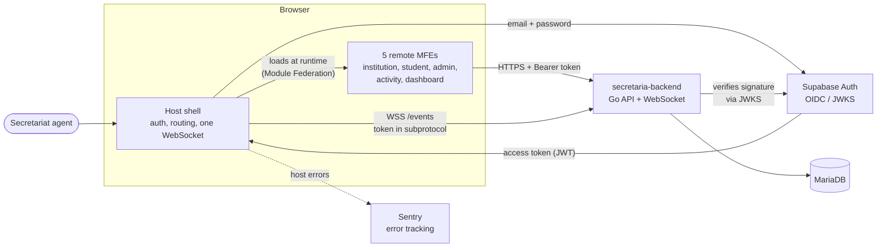
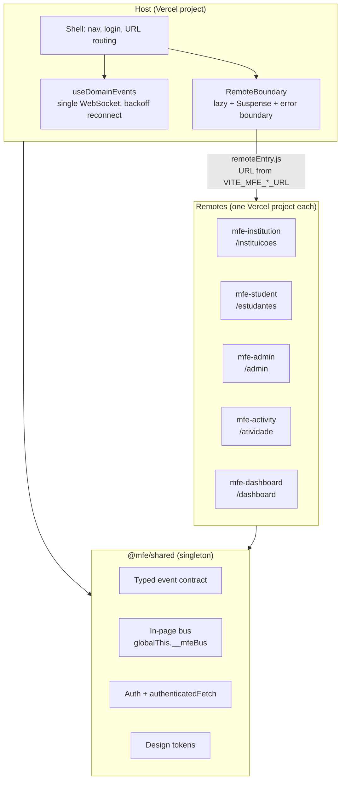
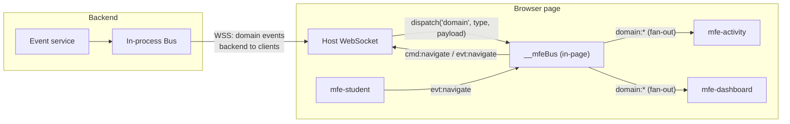
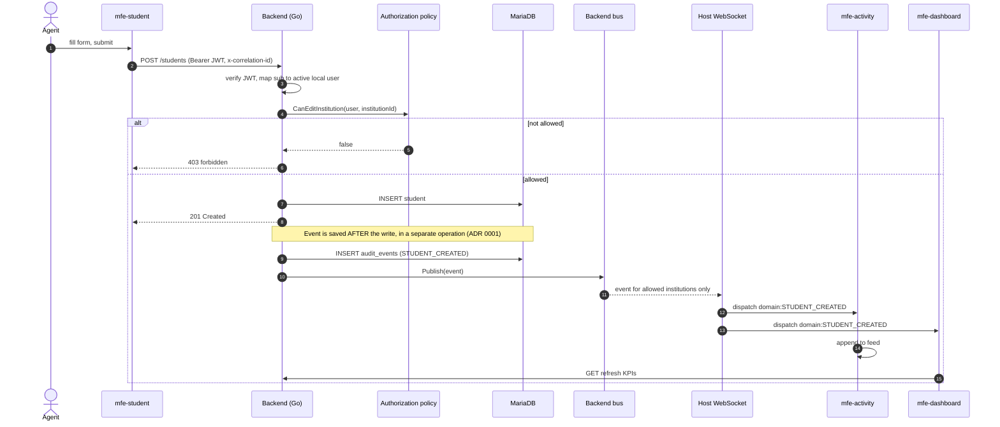
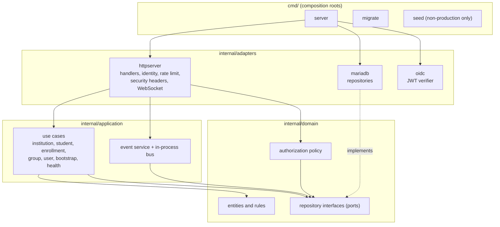
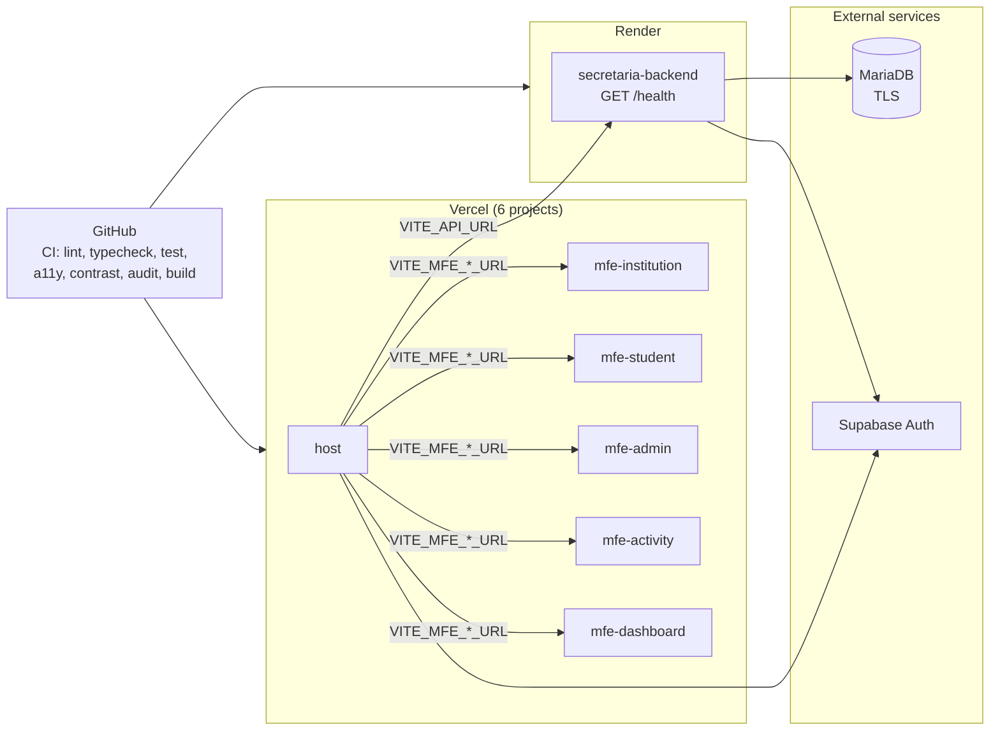
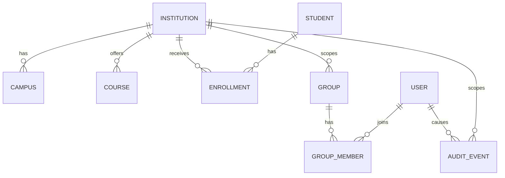

# Architecture

Diagrams for the School Secretariat platform. Frontend lives in this repository (`mfe-communication`); the API lives in [`secretaria-backend`](https://github.com/fidelis27/secretaria-backend). All diagrams are Mermaid and render on GitHub.

Contents: [1. System context](#1-system-context) · [2. Runtime composition](#2-runtime-composition-in-the-browser) · [3. Communication layers](#3-communication-layers) · [4. Main flow](#4-main-flow-create-a-student) · [5. Backend layers](#5-backend-layers-hexagonal) · [6. Deployment](#6-deployment-topology) · [7. Data model](#7-data-model) · [8. Known gaps](#8-known-gaps-reflected-in-the-diagrams)

---

## 1. System context

Who talks to whom, at the highest level.

---

## 2. Runtime composition in the browser

The host owns the shell. Remotes are separate builds, loaded lazily. React, React DOM and `@mfe/shared` are **singletons**, so every remote shares one session and one event bus.

If one remote is down, only its `RemoteBoundary` shows "module unavailable"; the shell and the other remotes keep working.

---

## 3. Communication layers

Two layers, each with one job.

| Layer | Scope | Channels | Use |
| --- | --- | --- | --- |
| Backend domain events over WebSocket | Server to every connected client | event `type` (for example `STUDENT_CREATED`) | State changes that other screens must react to |
| In-page bus | Same page only | `cmd:*` host to MFE, `evt:*` MFE to host, `domain:*` re-dispatched backend events | Navigation, modal close, connection status |

Bus delivery rules: no listener means a per-channel queue (100 items, TTL 10 s by default); once a listener exists, delivery is fan-out. Details in [`event-bus.md`](event-bus.md).

---

## 4. Main flow: create a student

The flow that the whole architecture exists to prove: *write, persist, publish, react*.

Failure behavior: if saving or publishing the event fails, the error is logged and the client still gets `201`. The write is not rolled back and the event can be lost. This is the documented trade-off until the transactional outbox exists.

---

## 5. Backend layers (hexagonal)

Dependencies point inward. The domain knows nothing about HTTP or SQL.

Request pipeline in front of every handler (outermost first): security headers, CORS, identity (JWT to local user), rate limit, then the mux. Observability wraps all of it.

---

## 6. Deployment topology

Each package builds and deploys on its own. The host only knows remote origins through build-time variables.

---

## 7. Data model

A student has one civil record and many enrollments over time; only one can be `active`. A transfer closes the origin enrollment and opens the destination in a single database transaction. The full column-level model is in [`diagramas.md`](diagramas.md).

---

## 8. Known gaps reflected in the diagrams

- **Event delivery is best effort** (diagram 4): the event is saved after the write, not in the same transaction. Fix: transactional outbox (backend ADR 0001).
- **Authorization is applied per handler** (diagram 5), not by a declarative route table (backend ADR 0003).
- **Single-instance bus:** the backend bus is in-process, so horizontal scaling needs a broker.
- **`mfe-student` opens its own WebSocket** even when hosted, unlike `mfe-activity` and `mfe-dashboard`, which only do so when the host is not ready. This contradicts diagram 3; either fix the code or change the diagram.
