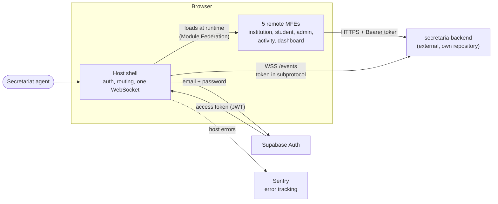
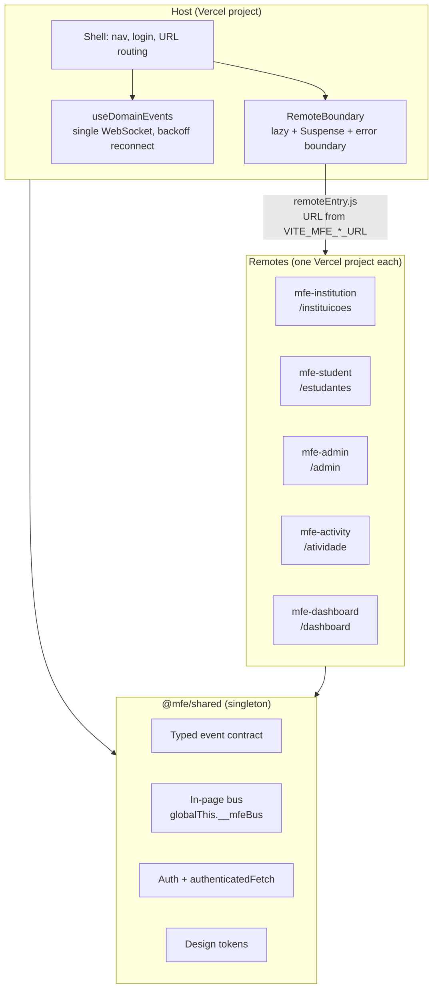
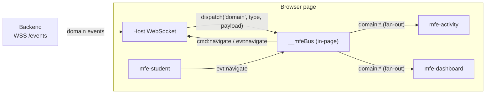
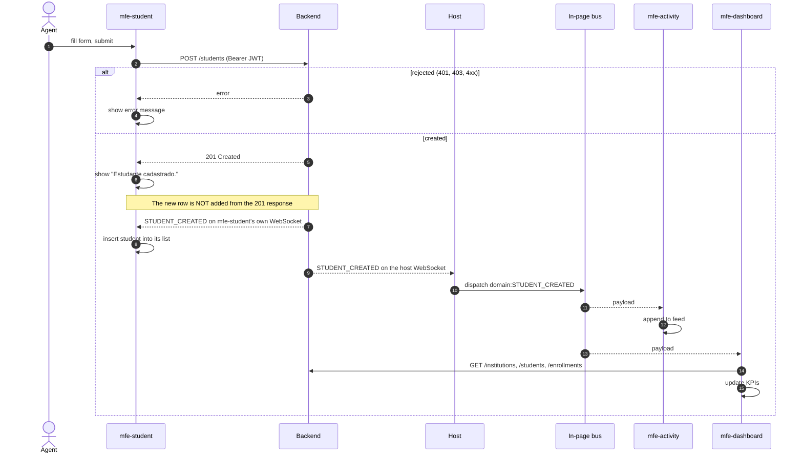
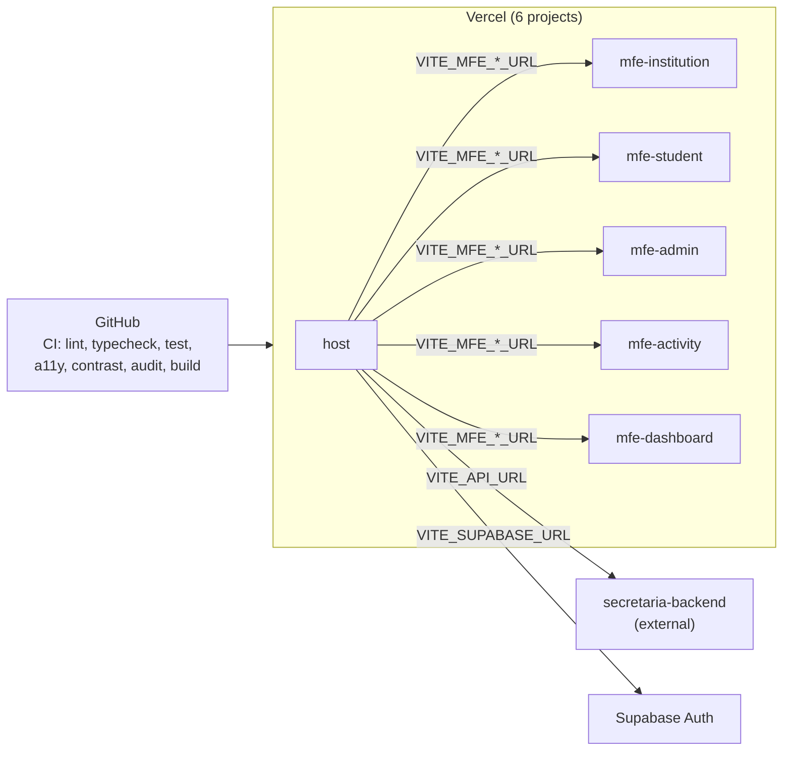

# Architecture

Diagrams for the micro-frontend platform in this repository. The Go API, its data model and its API contract are documented in [`secretaria-backend`](https://github.com/fidelis27/secretaria-backend/blob/main/docs/architecture.md); this page treats it as an external system.

Contents: [1. System context](#1-system-context) · [2. Runtime composition](#2-runtime-composition-in-the-browser) · [3. Communication layers](#3-communication-layers) · [4. Main flow](#4-main-flow-create-a-student) · [5. Event contract](#5-event-contract-frontend-vs-backend) · [6. Deployment](#6-deployment-topology) · [7. Known gaps](#7-known-gaps)

---

## 1. System context

---

## 2. Runtime composition in the browser

The host owns the shell. Remotes are separate builds, loaded lazily. React, React DOM and `@mfe/shared` are **singletons**, so every remote shares one session and one event bus.

If one remote is down, only its `RemoteBoundary` shows "module unavailable"; the shell and the other remotes keep working.

---

## 3. Communication layers

Two layers, each with one job.

| Layer                                | Scope                            | Channels                                                                          | Use                                            |
| ------------------------------------ | -------------------------------- | --------------------------------------------------------------------------------- | ---------------------------------------------- |
| Backend domain events over WebSocket | Server to every connected client | event `type` (for example `STUDENT_CREATED`)                                      | State changes that other screens must react to |
| In-page bus                          | Same page only                   | `cmd:*` host to MFE, `evt:*` MFE to host, `domain:*` re-dispatched backend events | Navigation, modal close, connection status     |

Bus delivery rules: no listener means a per-channel queue (100 items, TTL 10 s by default); once a listener exists, delivery is fan-out. Details in [`event-bus.md`](event-bus.md).

---

## 4. Main flow: create a student

The flow the architecture exists to prove: _write, react_. The backend is shown as one box; its internals are in the backend docs.

The student list depends on the event, not on the `201`. The backend publishes the event on a best-effort basis, so if it is lost the new student only shows up after the list is reloaded (on mount or with the reload button). Activity loads `/events/history` on mount for the same reason.

---

## 5. Event contract: frontend vs backend

What `@mfe/shared` declares, compared with what the backend emits today.

| Event type                                             | Declared in `@mfe/shared` | Emitted by backend | Consumed by         |
| ------------------------------------------------------ | ------------------------- | ------------------ | ------------------- |
| `STUDENT_CREATED`                                      | yes                       | yes                | Activity, Dashboard |
| `STUDENT_TRANSFERRED`                                  | yes                       | yes                | Activity, Dashboard |
| `ENROLLMENT_SUSPENDED`                                 | yes                       | yes                | Activity, Dashboard |
| `ENROLLMENT_REOPENED`                                  | yes                       | yes                | Activity, Dashboard |
| `INSTITUTION_CREATED`                                  | yes                       | **no**             | Dashboard           |
| `INSTITUTION_UPDATED`                                  | yes                       | **no**             | Dashboard           |
| `INSTITUTION_INACTIVATED`                              | yes                       | **no**             | Dashboard           |
| `STUDENT_UPDATED`                                      | yes                       | **no**             | Dashboard           |
| `ENROLLMENT_CREATED`                                   | no                        | yes                | nobody              |
| `USER_UPDATED`                                         | no                        | yes                | nobody              |
| `GROUP_MEMBERSHIP_UPDATED`, `GROUP_MEMBERSHIP_REMOVED` | no                        | yes                | nobody              |

Payload mismatch: the contract types `ENROLLMENT_SUSPENDED` and `ENROLLMENT_REOPENED` with an `institutionId`, but the backend payloads carry only `studentId`, `enrollmentId` (and `reason`, `date` for suspension). The backend side of this contract is in its [`openapi.yaml`](https://github.com/fidelis27/secretaria-backend/blob/main/docs/openapi.yaml).

---

## 6. Deployment topology

Each package builds and deploys on its own. The host only knows remote origins through build-time variables.

---

## 7. Known gaps

- **Event contract drift** (section 5): four declared types are never emitted, and four emitted types are not declared.
- **`mfe-student` opens its own WebSocket** even when hosted, unlike `mfe-activity` and `mfe-dashboard`, which only do so when the host is not ready. It needs it because its list is updated from `STUDENT_CREATED`, not from the `201`. This contradicts section 3 and the "one socket" rule; the fix is to add the created student from the response (or listen on the in-page bus) and drop the extra socket.
- **A lost event leaves the student list stale** (section 4), since the list is not refreshed after a successful create.
- **The frontend never sends `x-correlation-id`.** The backend generates one per event, so the correlation between "operation started" and "operation succeeded" described in `context.md` (decision 17) is not implemented.
- **Activity re-wraps live events** with a locally generated `eventId`, `source: "host-bus"` and `correlationId: "local-bus"`, so the real ids are lost and the same event loaded from history and received live can show twice.
- **Dashboard refetches three endpoints on every event** and ignores the payload. Fine for a prototype; see `performance-improvement-plan.md` before changing it.
- **Docs disagree on who can create students.** `context.md` says members may create students; the backend only allows admins of the institution (and superadmins).
- **Event delivery is best effort end to end.** There is no replay on reconnect other than the history call Activity makes on mount.
