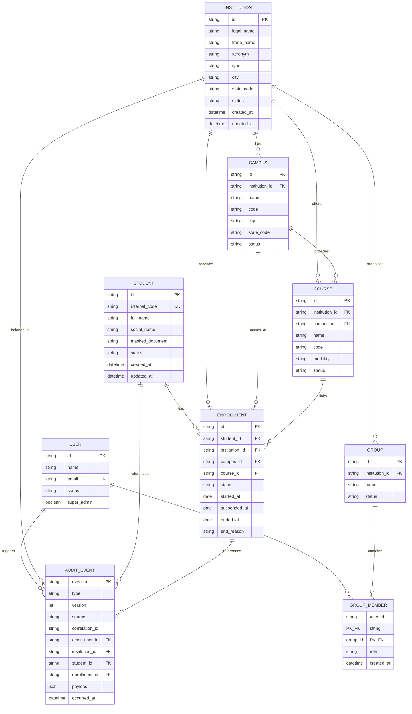

# Database and architecture diagrams

The diagrams below preserve the original conceptual data model. They are not a
description of the current database schema. Migrations `001`–`010` in the
separate [`secretaria-backend` architecture guide](https://github.com/fidelis27/secretaria-backend/blob/main/docs/architecture.md)
and [SQL migrations](https://github.com/fidelis27/secretaria-backend/tree/main/migrations)
define institutions, students, enrollments, users, groups, memberships, and
audit events. This conceptual model includes proposed `CAMPUS` and `COURSE`
entities; `GROUP_MEMBER` is a conceptual label for the implemented
`member_groups` table. Use the backend migrations as the schema source of truth.

## Initial conceptual relational model

The model treats a student as a single record and stores each institutional
relationship in `ENROLLMENT`, preserving transfer, suspension, reopening, and
history without duplicating the student.

## Relationship rules in the conceptual model

- An `INSTITUTION` can have multiple `CAMPUS` records.
- An `INSTITUTION` can offer multiple `COURSE` records.
- A `COURSE` belongs to an institution and may be associated with a campus.
- A `STUDENT` does not point directly to an institution.
- A `STUDENT` can have one or more historical `ENROLLMENT` records.
- The original MVP model allowed at most one `active` enrollment per student.
- A transfer ends the source enrollment and creates the destination enrollment
  in the same MariaDB/MySQL transaction.
- Suspending an enrollment preserves its history; reopening returns it to
  `active`.
- `GROUP_MEMBER` models the many-to-many relationship between users and groups.
- A user's role is applied within the group or institution scope.
- An `AUDIT_EVENT` is persisted before distribution over WebSocket.
- Activity may project events from `AUDIT_EVENT`; Dashboard may maintain
  derived projections but does not replace authoritative data.

Verify these rules against the backend schema and migrations before relying on
them as current implementation behavior.

## Constraints in the conceptual model

- `institution.id`, `campus.id`, `course.id`, `student.id`, `enrollment.id`,
  and `user.id` are primary keys.
- `student.internal_code` is unique under the chosen identification rule.
- `user.email` is unique.
- `enrollment.student_id`, `institution_id`, `course_id`, and status are
  required.
- Foreign keys must be enabled.
- Transfers and enrollment changes use a transaction.
- End dates cannot precede start dates.
- Personal identifiers must not be used as public keys or appear in logs.
- Event payloads follow data-minimization policy and, where needed, are
  encrypted or access-protected.

## Open questions in the original model

- Is `internal_code` globally unique or unique only within an institution?
- Can a course belong to multiple campuses without duplication?
- Should IDs use UUIDs or application-generated strings?
- Which Go migration mechanism should be used?
- What is the retention policy for `AUDIT_EVENT`?
